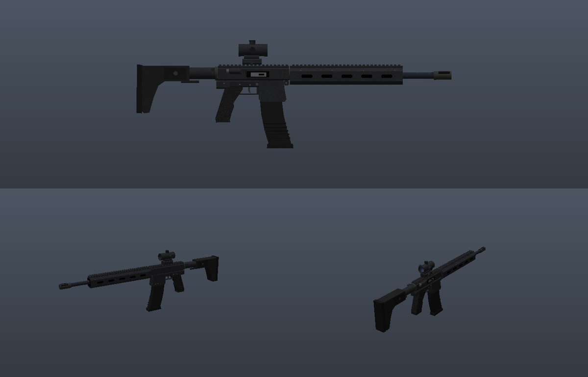
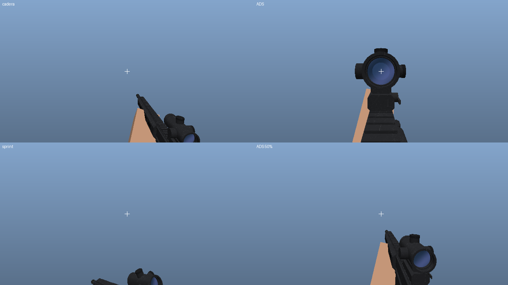

# FPS Realista — sistema de armas hiperrealista para Minecraft

> **Dos versiones:** mod para **Java (NeoForge 1.21.1)**, descrito aquí, y add-on para
> **Bedrock 1.21.130+**, descrito en [`bedrock/README.md`](bedrock/README.md). Ambas salen
> de los mismos modelos, animaciones, texturas y sonidos.

Mod para **NeoForge 1.21.1** (Java 21) que añade armas de fuego al estilo de los
shooters modernos: modelos 3D detallados, animaciones por fotogramas clave con
manos que siguen las piezas (IK), retroceso físico, apuntado con miras,
balística hitscan con autoridad del servidor y efectos (trazadoras, vainas,
agujeros de bala, humo).



## Armas

| Arma | Calibre | Cargador | Cadencia | Modos | Particularidades |
|---|---|---|---|---|---|
| Pistola 9 mm | 9×19 | 15+1 | 450 | Semi | Corredera que se queda abierta al vaciarse, miras de tritio, *press check* al inspeccionar |
| Carabina táctica 5,56 | 5,56×45 | 30+1 | 800 | Auto / Ráfaga / Semi | Punto rojo con retícula emisiva, guardamanos M-LOK, cerrojo abierto en vacío, palanca de carga |
| Fusil de asalto 7,62 | 7,62×39 | 30+1 | 600 | Auto / Semi | Madera, cargador que se engancha y “rueda” al recargar, mira de alza |
| Escopeta de corredera cal. 12 | 12 ga | 6+1 | 70 | Semi | 9 perdigones, recarga cartucho a cartucho interrumpible, corredera tras cada disparo |
| Rifle de precisión .308 | .308 Win | 5+1 | 60 | Semi | Mira 6× con overlay, cerrojo manual animado, bípode plegado, freno de boca |

Munición: `ammo_9mm`, `ammo_556`, `ammo_762`, `ammo_12g`, `ammo_308` (fabricables con
cobre, pólvora y hierro). Las armas usan `gun_parts` (hierro, redstone y cobre).

## Controles

| Acción | Tecla |
|---|---|
| Disparar | Clic izquierdo |
| Apuntar (ADS) | Clic derecho (mantener) |
| Recargar | `R` |
| Modo de fuego | `V` |
| Inspeccionar | `H` |

Todas se pueden cambiar en *Opciones → Controles → FPS Realista*.

## Qué hace “realista”

**Modelado**
- Formato de modelo propio (`assets/fpsrealista/gunmodels/*.json`) con primitivas
  `box` (con chaflanes), `cyl` (cilindros, conos y tubos huecos), `extrude`/`loft`
  (siluetas extruidas: empuñaduras, culatas, cargadores curvos) y `decal`
  (retículas, marcas grabadas). Se generan a malla en el juego con suavizado automático
  de normales.
- 15 materiales con texturas **repetibles de 512×512** generadas por ruido FFT periódico:
  aluminio anodizado con arañazos, polímero, punteado de empuñadura, fosfatado, pavonado,
  acero cepillado, nogal, latón, cobre, goma, FDE, cristal translúcido y emisivo.
- Huesos con piezas móviles: gatillo, selector, corredera, cerrojo, palanca de carga,
  corredera de escopeta, cargador y cartucho.

**Animación**
- Clips por fotogramas clave (`assets/fpsrealista/gunanims/*.json`): desenfundar,
  disparar, recarga táctica, recarga en vacío, inspección, corredera/cerrojo y recarga
  de escopeta en tres fases. Interpolación Catmull-Rom y curvas de easing.
- Los brazos del jugador (con su skin) se colocan con **IK** sobre localizadores del
  modelo: la mano izquierda va al cargador, la derecha al cerrojo, etc.
- Eventos sincronizados en la animación: sonidos mecánicos y expulsión de vainas.
- Capas procedurales: retroceso con muelles amortiguados (retroceso, cabeceo, guiñada y
  alabeo), balanceo con el ratón, movimiento en ocho al caminar, respiración, inclinación
  al desplazarse lateralmente, caída/salto, agachado y pose de carrera.

**Mecánica**
- Recámara (+1 en recarga táctica), modos semi/ráfaga/auto, sin disparar corriendo,
  apuntar ralentiza y cancela la carrera, sensibilidad del ratón proporcional al zoom.
- Retroceso de cámara con patrón vertical, deriva horizontal y recuperación parcial.
- Dispersión según postura, movimiento, salto y *bloom* por disparo.
- Balística hitscan en el servidor con semilla compartida (el cliente predice los mismos
  impactos), caída de daño por distancia, multiplicador de cabeza, penetración de varias
  entidades, rotura de cristal y paso a través de hojas.
- Cadencia validada en el servidor (cubo de fichas con tolerancia de latencia),
  munición y recargas autoritativas.

**Audiovisual**
- 30 sonidos sintetizados (disparos con chasquido supersónico, rafaga, golpe grave y
  reverberación con ecos; mecánica metálica; vainas que rebotan; silbidos de bala).
  Los disparos se oyen hasta a 150–256 bloques.
- Fogonazos aleatorios que iluminan el arma, humo, trazadoras, vainas con física,
  agujeros de bala que se desvanecen, astillas del bloque, sangre y cristales.
- HUD: munición con barra de cartuchos, modo de fuego, mira dinámica, marcador de
  impacto (blanco / amarillo en la cabeza / rojo al matar) y overlay de mira telescópica.



## Compilar

```bash
./gradlew build          # el .jar queda en build/libs/
./gradlew runClient      # lanza Minecraft con el mod
```

El workflow `.github/workflows/build.yml` compila en cada push y publica el `.jar` como
artefacto.

## Configuración del servidor

`config/fpsrealista-server.toml` (por mundo): multiplicador de daño, rotura de cristal,
paso por hojas, munición infinita en creativo y protección de mascotas propias.

## Herramientas de contenido (`tools/`)

Todo el contenido se genera desde Python (requiere `numpy`, `pillow`, `scipy`,
`soundfile` y `ffmpeg`):

```bash
python3 tools/gen_textures.py            # materiales, efectos, HUD, iconos
python3 tools/models/carbine_556.py      # (una por arma) escribe gunmodels/<arma>.json
python3 tools/gen_anims.py               # escribe gunanims/<arma>.json
python3 tools/gen_sounds.py              # sonidos OGG + sounds.json
python3 tools/preview.py <modelo.json> salida.png   # vista lateral y 3/4
python3 tools/fpview.py carbine_556                  # poses de cadera/ADS/carrera
python3 tools/fpview.py carbine_556 reload_empty 16  # hoja de fotogramas de un clip
```

`tools/gunlib.py` y `MeshBuilder.java` implementan el mismo generador de mallas, así que
las vistas previas coinciden con el juego. Los modelos y animaciones se pueden sustituir
con un paquete de recursos y recargar con `F3+T`.
