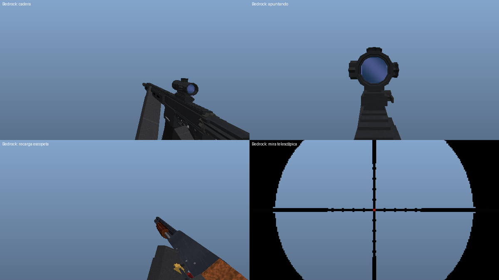

# FPS Realista — versión Bedrock (add-on)

Port del mod a **Minecraft Bedrock Edition** (Windows, Android, iOS, consolas) como
add-on: un *Behavior Pack* con la lógica en JavaScript (Script API) y un *Resource Pack*
con modelos, animaciones, texturas, sonidos y partículas.

- Requiere **Bedrock 1.21.130 o superior** (Script API `@minecraft/server` 2.4.0).
- No necesita experimentos activados.



## Instalación

1. Descarga `FPS_Realista.mcaddon`: en la pestaña *Actions* del repositorio
   (trabajo **bedrock**, artefacto `fpsrealista-bedrock`), o genéralo con
   `python3 tools/bedrock/build_bedrock.py` (sale en `dist/`).
2. Ábrelo con Minecraft: se importan los dos packs.
3. En el mundo, activa **FPS Realista** tanto en *Paquetes de comportamiento* como en
   *Paquetes de recursos*.
4. Las armas y la munición están en el inventario creativo (pestaña *Equipamiento*) y se
   fabrican en la mesa de trabajo con las mismas recetas que en Java.

## Controles (teclado, mando y táctil)

| Acción | Cómo |
|---|---|
| Disparar | Mantener **usar** (clic derecho / gatillo izquierdo / botón *Disparar*). Las armas automáticas disparan mientras se mantiene |
| Apuntar (ADS) | Mantener **agacharse** |
| Recargar | **Agacharse + saltar** (con el cargador lleno: inspeccionar el arma) |
| Modo de fuego | **Doble toque de agacharse** |

La munición, el modo de fuego y los impactos se muestran en la barra de acción.

## Qué incluye

- Las 5 armas con los mismos modelos que en Java, convertidos a cubos
  (de 171 a 469 por arma) y un atlas de texturas de 1024×512 por arma.
- **Manos con guantes y mangas tácticas** dentro del modelo del arma, con la IK de las
  animaciones de Java horneada fotograma a fotograma (la mano izquierda va al cargador,
  la derecha al cerrojo, etc.).
- Animaciones: desenfundar, disparo (corredera y cerrojo), recarga táctica y en vacío,
  inspección, corredera de escopeta, cerrojo del rifle y recarga cartucho a cartucho.
  Todas llevan sus sonidos y la expulsión de vainas sincronizados.
- Retroceso del arma con muelles amortiguados (Molang). También hay retroceso de cámara
  con recuperación parcial, sacudida de cámara y *bloom* de dispersión.
- Apuntado con interpolación suave, zoom de cámara (`camera.setFov`) y retícula de punto
  rojo alineada con el centro. El rifle .308 tiene un overlay de mira telescópica con
  retícula mil-dot.
- Balística hitscan en el servidor:
  - caída de daño por distancia;
  - multiplicador por disparo a la cabeza;
  - penetración de varias entidades;
  - rotura de cristal;
  - 9 perdigones en la escopeta.
- Partículas: fogonazo, humo, trazadoras, vainas con física y rebote, agujeros de bala,
  polvo, chispas y sangre.
- Silbido de bala para los jugadores cercanos a la trayectoria y marcador de impacto
  sonoro.

## Configuración

Con trucos activados:

```
/scriptevent fps:config breakGlass=false damage=1.5 infiniteCreative=true
```

## Diferencias con la versión Java (limitaciones de Bedrock)

- **Controles**: Bedrock no permite teclas propias ni detectar el clic izquierdo en el aire
  en esta versión de la API. Por eso se dispara con *usar* y se apunta agachándose.
- **Geometría**: Bedrock solo admite cubos (las mallas libres `poly_mesh` están
  obsoletas). Los cilindros se aproximan con cuadrados girados y las siluetas
  (empuñaduras, culatas, cargadores) con láminas de 3 mm.
- **Munición**: se guarda por jugador y tipo de arma, no en cada objeto. Reescribir el
  objeto en cada disparo reiniciaría su animación.
- **Mantener pulsado para disparar**: el arma usa el componente `minecraft:food` sin
  nutrición y con una duración de uso de una hora. Es la forma estable de que Bedrock
  avise de "empezar/dejar de usar".
- **`player.json`**: el pack sobrescribe el del jugador (copia del vanilla 1.21.130 más
  propiedades `fps:*`) para sincronizar las animaciones. Es incompatible con otros
  add-ons que también lo sobrescriban.

## Calibración

No pude probar el add-on dentro de Bedrock. La colocación del arma en primera persona se
calcula a partir de la pose vanilla del brazo (`animation.player.first_person.empty_hand`).
Se verificó con `tools/bedrock/simulate.py`, que reinterpreta los archivos generados con
las convenciones de Bedrock. Esas convenciones se dedujeron de modelos vanilla (la nariz
del aldeano, el morro del cerdo y la pose del arco).

Si en tu versión el arma aparece desplazada o algo gira al revés:

1. Ajusta `tools/bedrock/tuning.py`: altura del ojo, pose y escala en tercera persona.
2. Si fuera necesario, cambia las funciones `cp` y `cr` de `build_bedrock.py`, que fijan
   el signo de los ejes.
3. Vuelve a ejecutar `python3 tools/bedrock/build_bedrock.py`.

## Herramientas

```bash
python3 tools/bedrock/build_bedrock.py                 # genera bedrock/ y dist/FPS_Realista.mcaddon
python3 tools/bedrock/simulate.py carbine_556 reload 0.9   # vista previa 1a persona simulada
```
